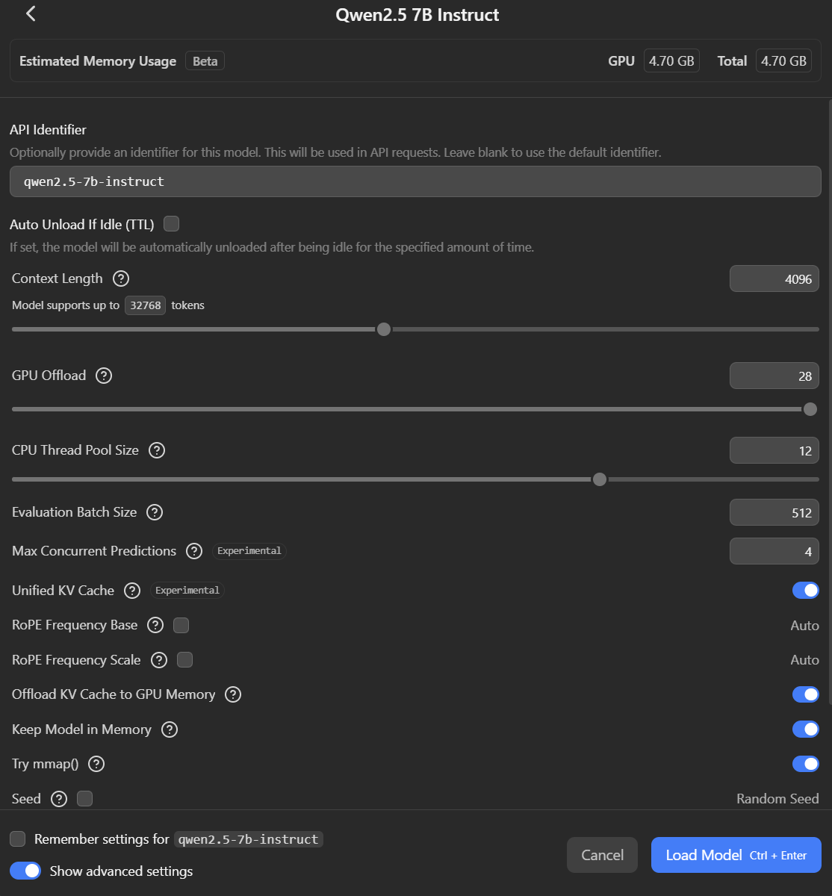
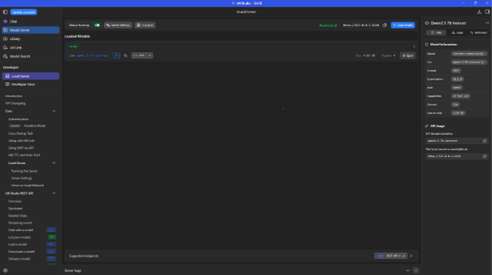
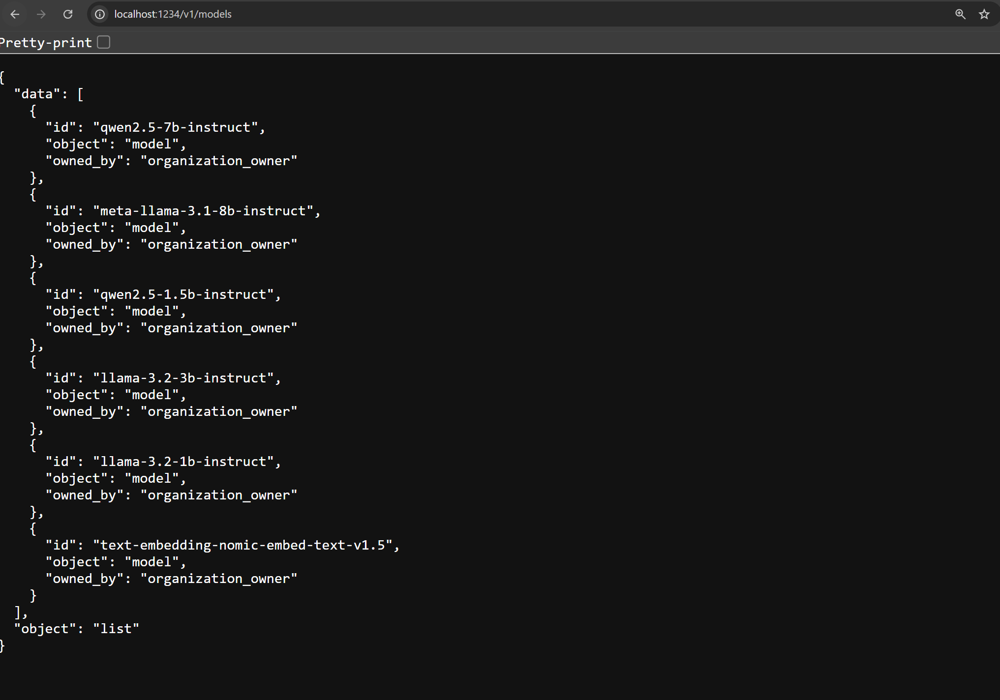
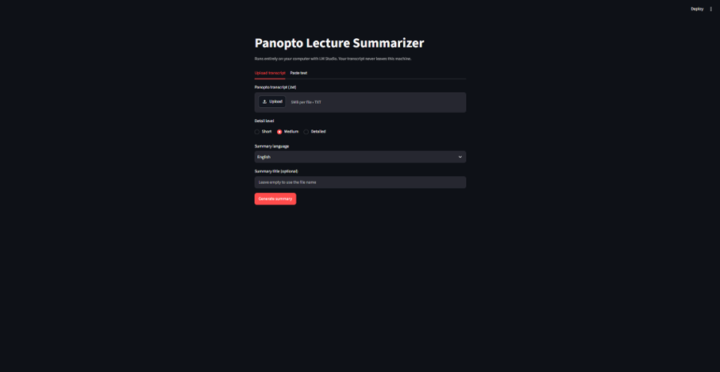

# Installation guide (Windows and macOS)

This guide takes you from nothing to your first lecture summary. It takes about 30 minutes, most of it waiting for downloads. Do the parts in order.

**What you need**

- A laptop with Windows 10/11 or macOS, at least 16 GB RAM and about 10 GB free disk space.
- An internet connection for the downloads. After that, the app works offline: everything runs on your own laptop.

Without a separate graphics card (or Apple Silicon Mac) the app still works, but a long lecture can take several minutes.

---

## 1. Install Python

**Windows**

1. Go to [python.org/downloads](https://www.python.org/downloads/) and download the latest Python 3 (3.11 or newer).
2. Run the installer. On the first screen, tick **"Add python.exe to PATH"**. This is important.
3. Click **Install Now**.

**macOS**

1. Go to [python.org/downloads](https://www.python.org/downloads/) and download the latest Python 3 (3.11 or newer) for macOS.
2. Open the `.pkg` file and click through the installer.

**Check it worked:** open a terminal (Windows: press the Windows key, type `cmd`, press Enter; macOS: press Cmd+Space, type `Terminal`, press Enter) and type:

- Windows: `python --version`
- macOS: `python3 --version`

It should show `Python 3.11` or higher. If Windows says it doesn't know `python`, reinstall Python with the PATH box ticked.

---

## 2. Install LM Studio and the model

LM Studio runs the AI model on your own laptop. The app sends your transcript to LM Studio, never to the internet.

### 2.1 Install LM Studio

1. Download **LM Studio** from [lmstudio.ai](https://lmstudio.ai). Take the normal LM Studio, not "LM Studio Bionic".
2. Install it with the default options and open it.
3. If it offers to download a starter model, you can skip that.

### 2.2 Download the model

1. Click **Model Search** in the menu on the left.
2. Search for `Qwen2.5-7B-Instruct`.
3. In the list of files, choose the one with **Q4_K_M** in its name (about 4.7 GB) and click **Download**.

### 2.3 Load the model with the right context length

1. Click the model bar at the top of the window (or **Load Model** on the Model Server screen) and choose **Qwen2.5-7B-Instruct**.
2. In the settings that appear, set **Context Length** to **16384**.
3. Click **Load**.



The context length matters: with the default (about 4,000) the model cannot read a long lecture, and the app shows "LM Studio returned 400".

### 2.4 Start the server

1. Click **Model Server** in the menu on the left.
2. Click **Server Settings** at the top and turn off **Just-in-Time Model Loading**. Otherwise LM Studio may load the model by itself with a too-small context length.
3. Turn on the **Status** switch at the top left, so it says **Status: Running**.
4. Check that your model is listed under **Loaded Models** with **READY**, and that it says **Reachable at: http://127.0.0.1:1234**.



### 2.5 Check the model id

Open [http://localhost:1234/v1/models](http://localhost:1234/v1/models) in your browser. You should see `"id": "qwen2.5-7b-instruct"`.



The app asks LM Studio for exactly this id (`MODEL_NAME` in `config.py`). If you see a different id, change `MODEL_NAME` in `config.py` to match.

---

## 3. Get the code

**Option A: download as ZIP (easiest)**

1. Open [github.com/playtonboy/panopto-transcript-summary-llm-](https://github.com/playtonboy/panopto-transcript-summary-llm-).
2. Click the green **Code** button, then **Download ZIP**.
3. Unzip it, for example into your Documents folder.

**Option B: with Git**

```
cd ~/Documents
git clone https://github.com/playtonboy/panopto-transcript-summary-llm-.git
```

---

## 4. Start the app

Make sure LM Studio is open with the server **Running** (part 2.4).

**Windows**

Open the project folder and double-click **`start.bat`**.

**macOS**

Open Terminal, go to the project folder and run the start script:

```
cd ~/Documents/panopto-transcript-summary-llm-
chmod +x start.sh
./start.sh
```

(Downloaded as ZIP? Then the folder may be called `panopto-transcript-summary-llm--main`. You only need `chmod +x start.sh` the first time.)

**What happens**

The first start takes a few minutes: the script creates a private Python environment (`.venv`) and installs the libraries. After that it starts three parts:

- the **orchestrator** (job queue) on `localhost:8000`,
- an **AI worker** that talks to LM Studio,
- the **interface** on `localhost:8501`.

Your browser opens the app by itself. If it doesn't, go to [http://localhost:8501](http://localhost:8501).



---

## 5. Your first summary

1. Get the transcript of a lecture as a **`.txt` file** (max 5 MB).
2. In the app, upload the file.
3. Choose the level of detail (Short, Medium or Detailed) and the language of the summary.
4. Start the summary. You see the progress while it runs. A short text takes about a minute; a full lecture can take several minutes, especially without a graphics card.
5. When it's done, you can copy the summary or download it as `.txt` or `.docx`.

Your transcript and summary are never saved to disk or sent to the internet. Closing the browser tab removes them.

---

## 6. Stop the app

- **Windows:** in the black window that `start.bat` opened, press **Ctrl+C**. When it asks "Terminate batch job (Y/N)?", type **N** and press Enter. Then the other windows close too.
- **macOS:** in Terminal, press **Ctrl+C**.

You can then close LM Studio as well.

---

## Problems

| What you see | What to do |
| --- | --- |
| `Python was not found` (Windows) | Reinstall Python and tick "Add python.exe to PATH" (part 1). |
| The app says LM Studio is not running | Open LM Studio, load the model and set the server to **Running** (parts 2.3 and 2.4). |
| `LM Studio returned 400` | The context length is too small. Eject the model, load it again with **Context Length 16384**, and check that **Just-in-Time Model Loading** is off (parts 2.3 and 2.4). |
| `The model took too long to answer` | Your laptop is too slow for this lecture. Close other programs and try a shorter transcript. |
| Wrong model / model not found | Check the id at [localhost:1234/v1/models](http://localhost:1234/v1/models) and make `MODEL_NAME` in `config.py` match (part 2.5). |
| `Permission denied` on macOS | Run `chmod +x start.sh` first, or start it with `bash start.sh`. |
