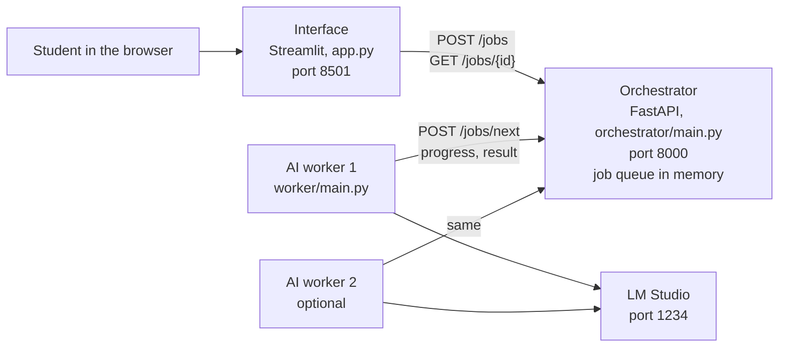

# How our summarizer is put together (Task 6)

Before Task 6, the Streamlit page did everything itself and froze while the model was working. Now the work is split
over three small programs that talk to each other through a simple web API.



- **Interface** (`app.py`): handles the upload and shows progress and the summary. It never calls the model.
- **Orchestrator** (`orchestrator/`): keeps the queue of jobs and gives each job to exactly one worker.
- **AI workers** (`worker/`): take the next job, run `summarize()` with LM Studio and send back the result. Need more
  speed? Start another worker.

Everything runs on the student's own laptop (`localhost`), so transcripts never leave it.

## API (port 8000)

Please don't rename these without telling the team, because the code depends on them.

| Who | Request | Answer |
| --- | --- | --- |
| Interface | `POST /jobs` with `{"text", "title", "speakers", "detail_level", "language"}` | `201` `{"id": "..."}` |
| Interface | `GET /jobs/{id}` | `{"id", "status", "progress", "message", "title", "body", "error"}`, or `404` |
| Worker | `POST /jobs/next?worker=<name>` | `200` with the job, or `204` when the queue is empty |
| Worker | `POST /jobs/{id}/progress` with `{"fraction", "message"}` | `200` |
| Worker | `POST /jobs/{id}/result` with `{"title", "body"}` | `200` |
| Worker | `POST /jobs/{id}/error` with `{"message"}` | `200` |
| Anyone | `GET /health` | `{"status": "ok", "workers": <workers seen in the last 10 s>}` |

A job goes `queued` → `running` → `done` or `failed`.

## Why we chose this

- **FastAPI with an in-memory SQLite queue:** easy to build and test, nothing extra to install, and transcripts are
  never written to disk (SCRUM-29).
- **Workers ask for work:** the orchestrator doesn't need to know which workers exist, so adding one is trivial.
- **Failures are always reported:** a job with no progress for `JOB_STALE_S` seconds is retried once, then marked as
  failed. The interface checks `GET /health` first, so the student hears right away if nothing is running (SCRUM-53).


## Starting it

With LM Studio running, open three terminals (or use `start.sh` / `start.bat`):

```
python -m uvicorn orchestrator.main:app --port 8000
python -m worker.main
streamlit run app.py
```